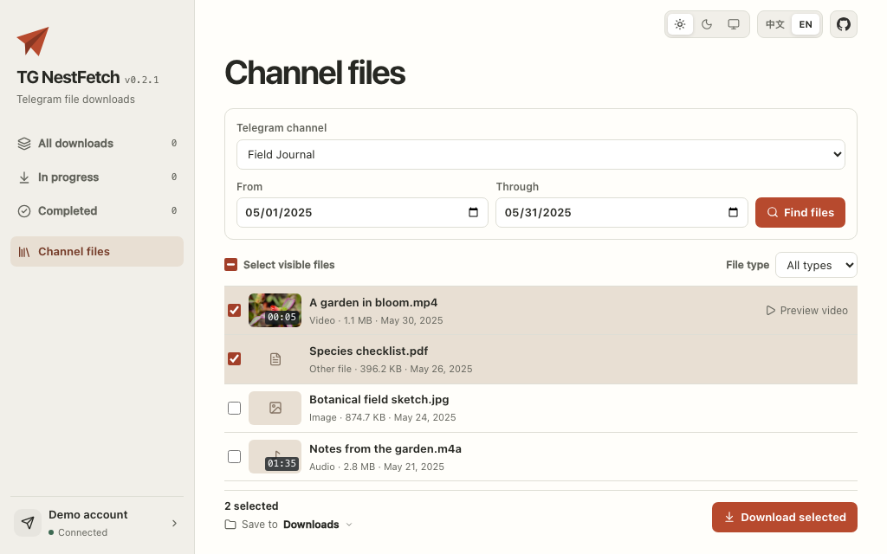
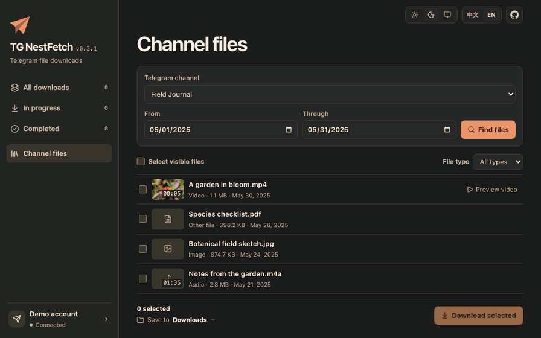

# TG NestFetch

Browse Telegram channels, preview videos, and batch-download attachments to a folder you choose.

[Download for macOS, Windows, or Linux](https://github.com/TNT-Likely/telegram-nestfetch/releases/latest) · [简体中文](README.zh-CN.md)



## What you can do

- Paste a Telegram message link to download a video, image, audio file, or document.
- Open **Channel files**, pick a subscribed channel or paste a public channel link, and browse a date range. Filter by file type and queue several attachments at once.
- Preview a video before saving. The player shows buffering progress and Telegram transfer speed, and lets you jump to another part of the video.
- Play finished videos from the **Completed** list, including offline playback from local storage.
- Save to a local folder or a mounted network volume. Pause, retry, or choose a new destination from the download queue.

The interface supports English and Simplified Chinese in light, dark, and system appearance.

## Demo



The demo uses an example channel and a sample video from MDN. [Sample video](https://github.com/mdn/interactive-examples/blob/main/live-examples/media/cc0-videos/flower.mp4)

<a name="install-and-use"></a>
<a name="安装与使用"></a>

## Install and sign in

Download the package for your computer. [Latest release](https://github.com/TNT-Likely/telegram-nestfetch/releases/latest)

| Platform | Package |
| --- | --- |
| macOS 13+ | `aarch64.dmg` for Apple silicon or `x64.dmg` for Intel |
| Windows 10/11 (x64) | `x64-setup.exe` |
| Linux (x86-64) | `amd64.deb` or `amd64.AppImage`, built on Ubuntu 22.04 |

<a name="install-on-macos"></a>

- **macOS** · Open the DMG and drag **TG NestFetch** to **Applications**. The app carries an ad hoc signature. If macOS blocks the first launch, try opening the app once, then choose **Open Anyway** in **System Settings → Privacy & Security**. [Apple support](https://support.apple.com/guide/mac-help/open-a-mac-app-from-an-unidentified-developer-mh40616/mac)
- **Windows** · Run the setup `.exe`. The installer is unsigned and downloads WebView2 if the runtime is missing.
- **Linux** · From the download directory, install with `sudo apt install ./TG-NestFetch_*_amd64.deb`. To run the AppImage, give it execute permission with `chmod +x TG-NestFetch_*_amd64.AppImage` and then run `./TG-NestFetch_*_amd64.AppImage`.

In TG NestFetch, choose **Sign in with QR code**. On your phone, open **Telegram → Settings → Devices → Link Desktop Device** and scan the code. Enter your two-step verification password if prompted.

The app bundles [tdl](https://github.com/iyear/tdl) and uses a separate Telegram session. A preview waits for the current transfer to finish or pause, and closing the player lets the queue continue. Resuming an interrupted tdl download restarts that file. A finished transfer stays in local staging when its destination is unavailable, so you can retry saving it or choose another folder.

## Build from source

The build workflow uses Node.js 24, Go 1.27, and stable Rust. Install the system dependencies for your platform. On Linux, also install `gstreamer1.0-plugins-good` and `gstreamer1.0-libav` for video playback. [Tauri prerequisites](https://v2.tauri.app/start/prerequisites/)

```sh
npm ci
npm --prefix ui ci
npm run dev
```

```sh
npm run check
go -C engine test -mod=readonly ./...
npm run build
```

The build checks the SHA-256 of the upstream tdl archive and compiles tdl with patches for QR sign-in, attachment browsing, and local video streaming. The app bundles tdl's executable, license, and corresponding source. Builds using a registered Telegram application can set `TG_NESTFETCH_TELEGRAM_APP_FILE` to a private JSON file containing `apiId` and `apiHash`. [Telegram developer tools](https://my.telegram.org/apps)

## License

TG NestFetch is licensed under [MIT](LICENSE). The separately bundled tdl utility is licensed under [AGPL-3.0](src-tauri/resources/tdl/LICENSE). [tdl source and attribution](src-tauri/resources/tdl/NOTICE)
