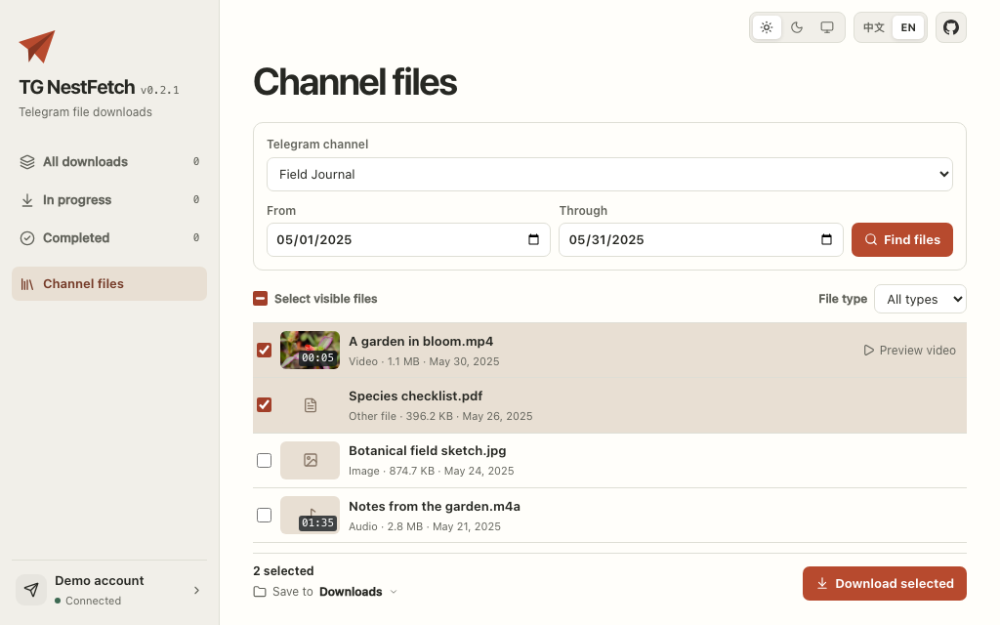
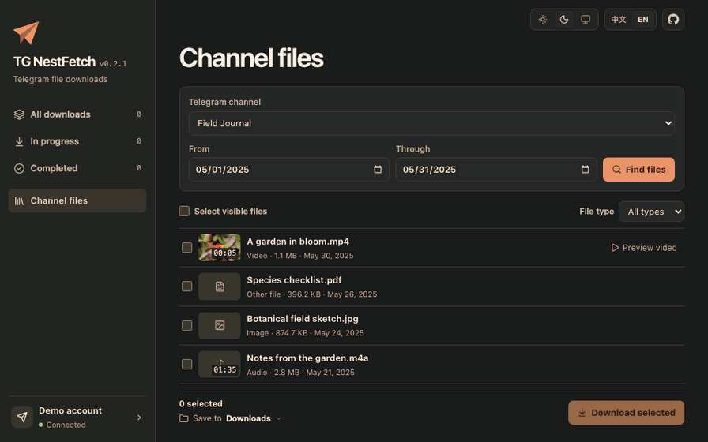

# TG NestFetch

浏览 Telegram 频道附件，试看视频，把选中的文件批量保存到指定目录。

[下载 macOS、Windows 或 Linux 版](https://github.com/TNT-Likely/telegram-nestfetch/releases/latest) · [English](README.md)

## 主要功能

- 粘贴 Telegram 消息链接，下载视频、图片、音频或文档。
- 在「频道附件」中选择已加入的频道，或粘贴公开频道链接。按日期和文件类型筛选后，可以勾选多项加入下载队列。
- 在应用内试看视频，查看缓冲进度和 Telegram 取流速度，也可以拖动播放进度条。
- 从「已完成」列表直接播放已保存的视频，本地文件支持离线播放。
- 在下载详情查看 Telegram 原消息和保存位置，也可以隐藏或恢复已完成记录、取消未完成任务。
- 保存到本地目录或已挂载的网络卷。下载队列支持暂停、重试和更换保存目录。

界面支持简体中文、English，以及日间、暗黑和跟随系统外观。

## 操作演示

演示使用示例频道和 MDN 的视频样片。[样片来源](https://github.com/mdn/interactive-examples/blob/main/live-examples/media/cc0-videos/flower.mp4)

## 安装和登录

按操作系统选择安装包。[最新版本](https://github.com/TNT-Likely/telegram-nestfetch/releases/latest)

| 平台 | 安装包 |
| --- | --- |
| macOS 13 或更新版本 | Apple 芯片选 `aarch64.dmg`，Intel 芯片选 `x64.dmg` |
| Windows 10/11（x64） | `x64-setup.exe` |
| Linux（x86-64） | `amd64.deb` 或 `amd64.AppImage`，基于 Ubuntu 22.04 构建 |

- **macOS** · 打开 DMG，将 **TG NestFetch** 拖入「应用程序」。应用采用临时签名。如果系统拦截首次启动，可以先尝试打开应用，再到「系统设置 → 隐私与安全性」选择「仍要打开」。[Apple 支持](https://support.apple.com/guide/mac-help/open-a-mac-app-from-an-unidentified-developer-mh40616/mac)
- **Windows** · 运行 `.exe` 安装包。安装包未签名，如果系统缺少 WebView2，安装时会联网下载。
- **Linux** · 在下载目录用 `sudo apt install ./TG-NestFetch_*_amd64.deb` 安装 DEB。也可以用 `chmod +x TG-NestFetch_*_amd64.AppImage` 添加执行权限，再用 `./TG-NestFetch_*_amd64.AppImage` 启动。

在应用中打开登录二维码，再用手机 Telegram 的「设置 → 设备 → 连接桌面设备」扫码。开启两步验证的账号按提示输入密码。

安装包内置 [tdl](https://github.com/iyear/tdl)，使用独立的 Telegram 会话。当前下载完成或暂停后开始试看，关闭播放器后队列继续。恢复中断的 tdl 下载会重新传输该文件。文件传输完成后如果保存目录离线，则保留在本机暂存区，之后可以重试保存或选择其他目录。

## 代理和软件更新

- 在「设置 → Telegram 代理」填写带端口的 HTTP 或 SOCKS5 地址，例如 `socks5://127.0.0.1:7890`。可以先测试连接，再保存。需要认证时可使用 `协议://用户名:密码@主机:端口`，其中用户名和密码按 URL 格式编码。
- 在「设置 → 软件更新」中检查新版本。macOS、Windows 安装版和 Linux AppImage 支持在应用内安装签名更新。Linux DEB 用户可从这里打开发布页，再用系统包管理器安装新版 DEB。

开发、构建与许可证信息见英文说明。[Build from source](README.md#build-from-source) · [License](README.md#license)
